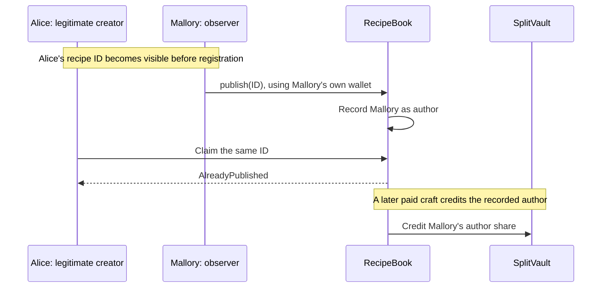
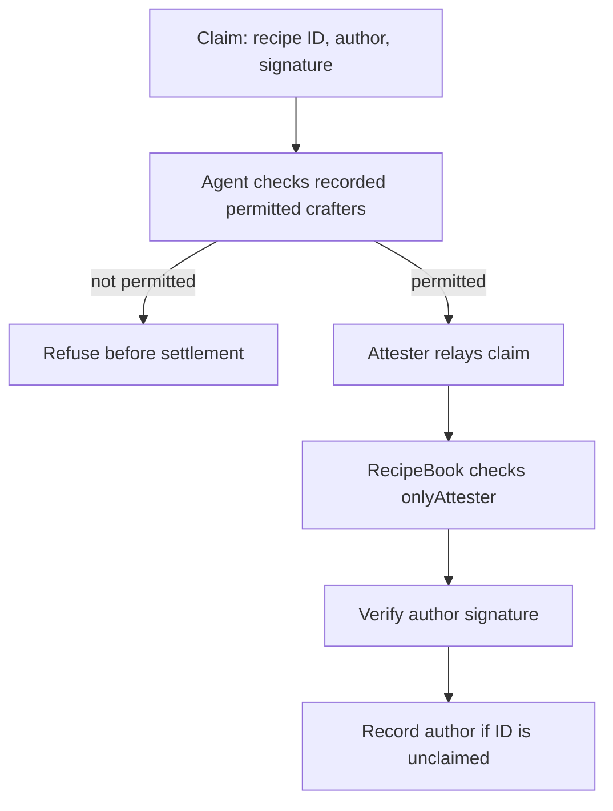

# SR-01: before and after

## Original path

The preserved original PoC log covers this direct-publication attack plus a legitimate signed-relay control. Source inspection also establishes why Mallory's own valid signature could satisfy the original `publishFor` checks; that variant is not claimed as an execution in the same historical PoC log.

## Implemented fix

The contract gates **both** `publish` and `publishFor`. The signed route additionally checks the author signature. The attester must accurately enforce provenance: the contract alone cannot determine who crafted the content. Identical recipes may have more than one permitted crafter; the first permitted registration wins.

This is an authorization/provenance issue, not broken EIP-712 cryptography. Test coverage is not a claim that every web, payment, identity or deployment path was audited.

Read [CASE-STUDY.md](CASE-STUDY.md) for exact source snapshots, prerequisites and evidence limits.
