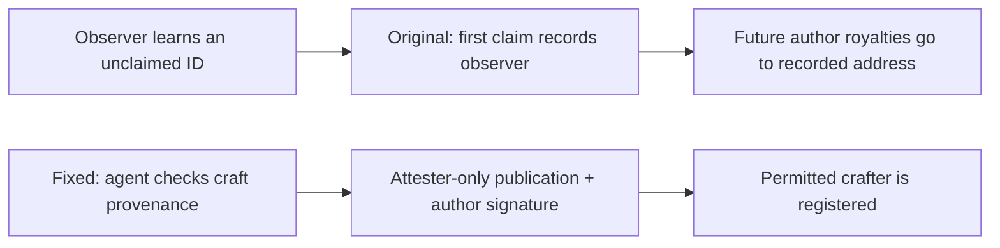

# Voxel Bench SR-01: recipe authorship capture

**ETHOnline 2026 security contribution.** The project credits Stefan for identifying SR-01 through AI-assisted contract review and local test work. The team implemented the fix and marks the finding closed.

**What went wrong:** knowing an unclaimed recipe ID was enough to register yourself as its author. A valid self-signature proved control of a wallet, not that the claimant created the recipe. Future crafts then credited the recorded author.

**What changed:** both publication routes require a trusted attester; the agent checks its private craft records before relaying a claim, and the author signature remains required.

These are separate original and fixed flows. The attester remains trusted.

## Read in order

1. [Flow and trust boundary](FLOW.md)
2. [Full case study](CASE-STUDY.md)
3. [Reading guide and evidence map](READING-GUIDE.md)
4. [Pinned source and evidence inventory](SOURCES.json)

[Project acknowledgement](https://github.com/ETH-GLOBAL-ONLINE/voxel-bench/blob/2734fc4e31a6763986a62d5bdf2704e770c1c71d/docs/CONTRACT_AUDIT.md#findings) · [Upstream fix](https://github.com/ETH-GLOBAL-ONLINE/voxel-bench/commit/ba067ec240835cbc9e03bb991e644b75a1f30eb6) · [Web3 portfolio](https://github.com/Keedz1Off/web3-security-portfolio)

This entry reviews source and preserved historical results. No new target execution, current-chain validation, bounty payment, prize, CVE or production-loss claim is made.
